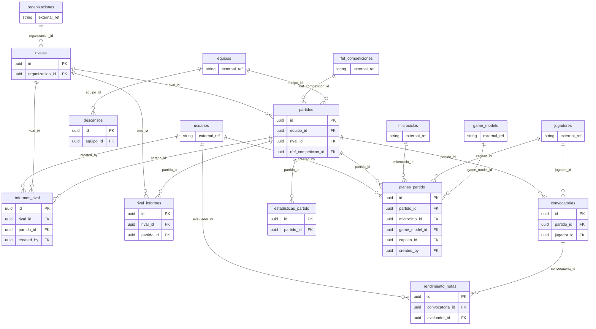
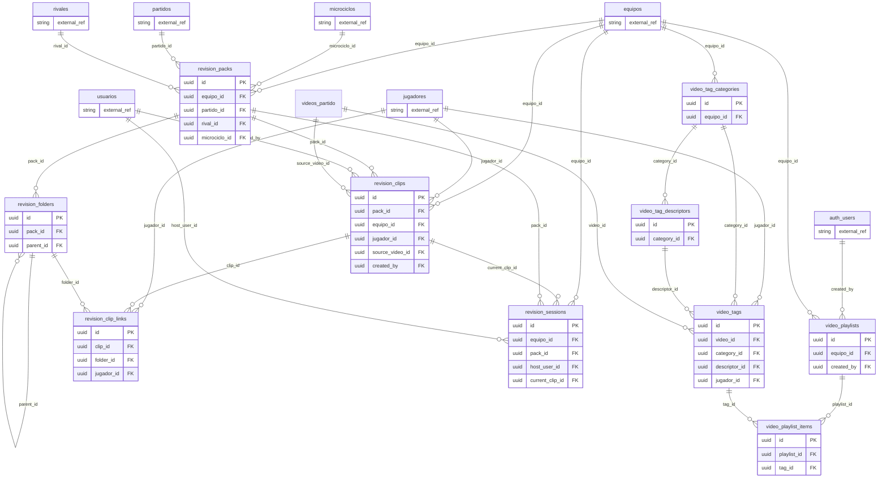
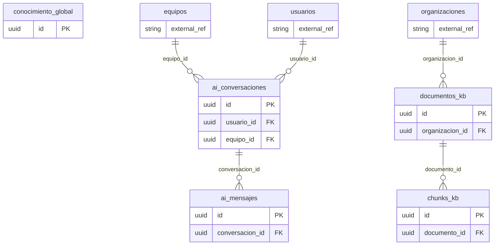
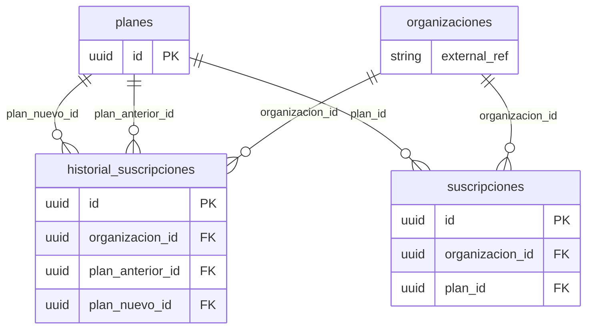
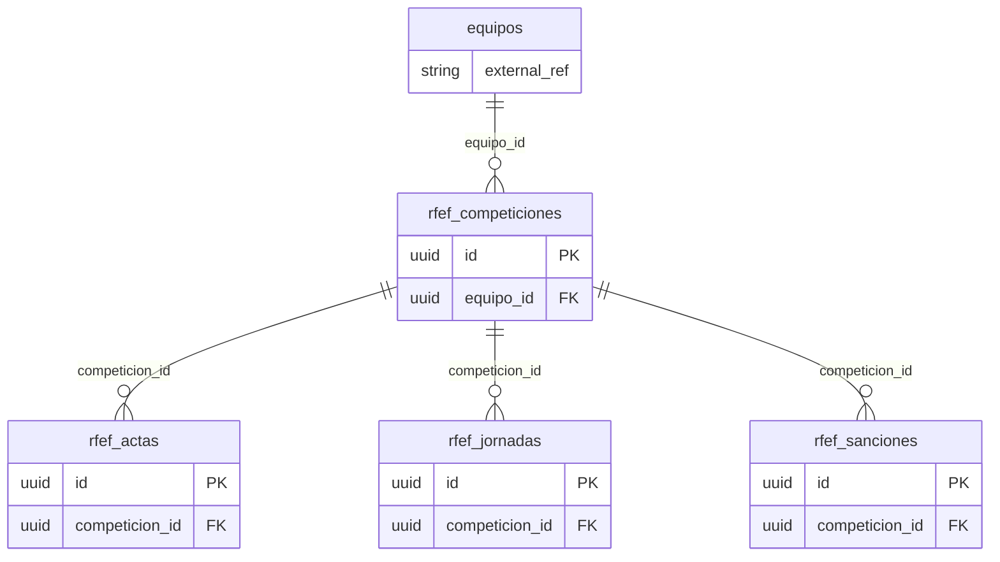
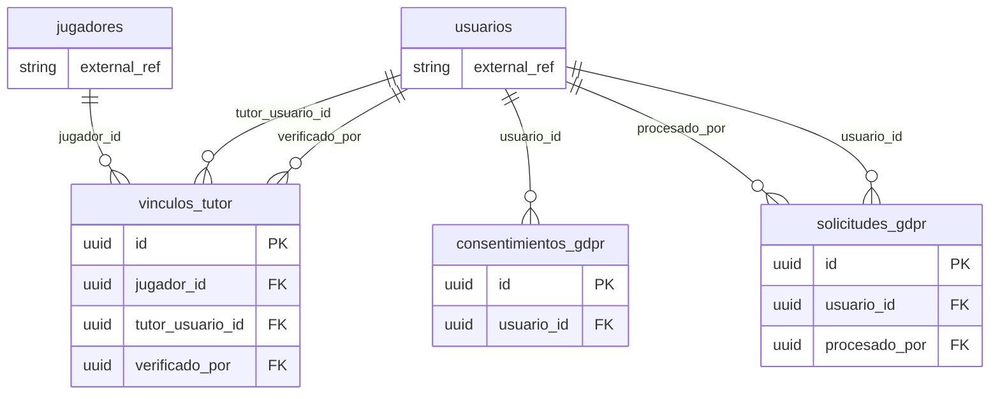

```mermaid
erDiagram
  organizaciones {
    uuid id PK
    uuid owner_id FK
  }
  equipos {
    uuid id PK
    uuid organizacion_id FK
    uuid temporada_anterior_id FK
  }
  usuarios {
    uuid id PK
    uuid organizacion_id FK
  }
  usuarios_equipos {
    uuid id PK
    uuid usuario_id FK
    uuid equipo_id FK
  }
  jugadores {
    uuid id PK
    uuid equipo_id FK
    uuid equipo_origen_id FK
    uuid usuario_id FK
  }
  posiciones {
    varchar codigo PK
  }
  notificaciones {
    uuid id PK
    uuid usuario_id FK
  }
  conversaciones {
    uuid id PK
    uuid equipo_id FK
    uuid creado_por FK
  }
  mensajes {
    uuid id PK
    uuid conversacion_id FK
    uuid autor_id FK
  }
  conversacion_participantes {
    uuid id PK
    uuid conversacion_id FK
    uuid usuario_id FK
  }
  onboarding_progreso {
    uuid id PK
    uuid usuario_id FK
  }
  audit_log {
    uuid id PK
    uuid usuario_id FK
    uuid organizacion_id FK
    uuid equipo_id FK
  }
  background_tasks {
    uuid id PK
    uuid usuario_id FK
    uuid organizacion_id FK
  }
  invitaciones {
    uuid id PK
    uuid organizacion_id FK
    uuid equipo_id FK
    uuid invitado_por FK
    uuid aceptado_por FK
    uuid jugador_id FK
  }
  transferencias_propiedad {
    uuid id PK
    uuid equipo_id FK
    uuid de_usuario_id FK
    uuid a_usuario_id FK
  }
  permisos_personalizados {
    uuid id PK
    uuid equipo_id FK
    uuid usuario_id FK
  }
  alertas {
    uuid id PK
    uuid equipo_id FK
    uuid microciclo_id FK
    uuid resuelta_por FK
  }
  auth_users { string external_ref }
  microciclos { string external_ref }
  auth_users ||--o{ organizaciones : "owner_id"
  auth_users ||--o{ usuarios : "id"
  conversaciones ||--o{ conversacion_participantes : "conversacion_id"
  conversaciones ||--o{ mensajes : "conversacion_id"
  equipos ||--o{ alertas : "equipo_id"
  equipos ||--o{ audit_log : "equipo_id"
  equipos ||--o{ conversaciones : "equipo_id"
  equipos ||--o{ equipos : "temporada_anterior_id"
  equipos ||--o{ invitaciones : "equipo_id"
  equipos ||--o{ jugadores : "equipo_id"
  equipos ||--o{ jugadores : "equipo_origen_id"
  equipos ||--o{ permisos_personalizados : "equipo_id"
  equipos ||--o{ transferencias_propiedad : "equipo_id"
  equipos ||--o{ usuarios_equipos : "equipo_id"
  jugadores ||--o{ invitaciones : "jugador_id"
  microciclos ||--o{ alertas : "microciclo_id"
  organizaciones ||--o{ audit_log : "organizacion_id"
  organizaciones ||--o{ background_tasks : "organizacion_id"
  organizaciones ||--o{ equipos : "organizacion_id"
  organizaciones ||--o{ invitaciones : "organizacion_id"
  organizaciones ||--o{ usuarios : "organizacion_id"
  usuarios ||--o{ alertas : "resuelta_por"
  usuarios ||--o{ audit_log : "usuario_id"
  usuarios ||--o{ background_tasks : "usuario_id"
  usuarios ||--o{ conversacion_participantes : "usuario_id"
  usuarios ||--o{ conversaciones : "creado_por"
  usuarios ||--o{ invitaciones : "aceptado_por"
  usuarios ||--o{ invitaciones : "invitado_por"
  usuarios ||--o{ jugadores : "usuario_id"
  usuarios ||--o{ mensajes : "autor_id"
  usuarios ||--o{ notificaciones : "usuario_id"
  usuarios ||--o{ onboarding_progreso : "usuario_id"
  usuarios ||--o{ permisos_personalizados : "usuario_id"
  usuarios ||--o{ transferencias_propiedad : "a_usuario_id"
  usuarios ||--o{ transferencias_propiedad : "de_usuario_id"
  usuarios ||--o{ usuarios_equipos : "usuario_id"
```

```mermaid
erDiagram
  categorias_tarea {
    uuid id PK
  }
  tareas {
    uuid id PK
    uuid categoria_id FK
    uuid organizacion_id FK
    uuid equipo_id FK
    uuid creado_por FK
    uuid tarea_origen_id FK
  }
  sesiones {
    uuid id PK
    uuid equipo_id FK
    uuid creado_por FK
    uuid microciclo_id FK
    uuid plan_partido_id FK
    uuid partido_id FK
  }
  sesion_tareas {
    uuid id PK
    uuid sesion_id FK
    uuid tarea_id FK
  }
  match_day_config {
    varchar codigo PK
  }
  contenidos {
    uuid id PK
    uuid contenido_padre_id FK
  }
  tareas_contenidos {
    uuid id PK
    uuid tarea_id FK
    uuid contenido_id FK
  }
  microciclos {
    uuid id PK
    uuid equipo_id FK
    uuid partido_id FK
    uuid rival_id FK
    uuid game_model_id FK
  }
  entrenamientos_margen {
    uuid id PK
    uuid sesion_id FK
    uuid jugador_id FK
    uuid registro_medico_id FK
  }
  entrenamientos_margen_tareas {
    uuid id PK
    uuid entrenamiento_margen_id FK
    uuid tarea_id FK
  }
  asistencias_sesion {
    uuid id PK
    uuid sesion_id FK
    uuid jugador_id FK
  }
  portero_tareas {
    uuid id PK
    uuid sesion_id FK
    uuid equipo_id FK
  }
  game_models {
    uuid id PK
    uuid equipo_id FK
    uuid created_by FK
  }
  tactical_boards {
    uuid id PK
    uuid equipo_id FK
    uuid created_by FK
  }
  tactical_board_frames {
    uuid id PK
    uuid board_id FK
  }
  abp_jugadas {
    uuid id PK
    uuid equipo_id FK
  }
  abp_rival_jugadas {
    uuid id PK
    uuid rival_id FK
  }
  abp_partido_jugadas {
    uuid id PK
    uuid partido_id FK
    uuid jugada_id FK
  }
  abp_sesion_jugadas {
    uuid id PK
    uuid sesion_id FK
    uuid jugada_id FK
  }
  abp_partido_plan {
    uuid id PK
    uuid partido_id FK
  }
  equipaciones {
    uuid id PK
    uuid rival_id FK
    uuid organizacion_id FK
  }
  auth_users { string external_ref }
  equipos { string external_ref }
  jugadores { string external_ref }
  organizaciones { string external_ref }
  partidos { string external_ref }
  planes_partido { string external_ref }
  registros_medicos { string external_ref }
  rivales { string external_ref }
  usuarios { string external_ref }
  abp_jugadas ||--o{ abp_partido_jugadas : "jugada_id"
  abp_jugadas ||--o{ abp_sesion_jugadas : "jugada_id"
  auth_users ||--o{ tactical_boards : "created_by"
  categorias_tarea ||--o{ tareas : "categoria_id"
  contenidos ||--o{ contenidos : "contenido_padre_id"
  contenidos ||--o{ tareas_contenidos : "contenido_id"
  entrenamientos_margen ||--o{ entrenamientos_margen_tareas : "entrenamiento_margen_id"
  equipos ||--o{ abp_jugadas : "equipo_id"
  equipos ||--o{ game_models : "equipo_id"
  equipos ||--o{ microciclos : "equipo_id"
  equipos ||--o{ portero_tareas : "equipo_id"
  equipos ||--o{ sesiones : "equipo_id"
  equipos ||--o{ tactical_boards : "equipo_id"
  equipos ||--o{ tareas : "equipo_id"
  game_models ||--o{ microciclos : "game_model_id"
  jugadores ||--o{ asistencias_sesion : "jugador_id"
  jugadores ||--o{ entrenamientos_margen : "jugador_id"
  microciclos ||--o{ sesiones : "microciclo_id"
  organizaciones ||--o{ equipaciones : "organizacion_id"
  organizaciones ||--o{ tareas : "organizacion_id"
  partidos ||--o{ abp_partido_jugadas : "partido_id"
  partidos ||--o{ abp_partido_plan : "partido_id"
  partidos ||--o{ microciclos : "partido_id"
  partidos ||--o{ sesiones : "partido_id"
  planes_partido ||--o{ sesiones : "plan_partido_id"
  registros_medicos ||--o{ entrenamientos_margen : "registro_medico_id"
  rivales ||--o{ abp_rival_jugadas : "rival_id"
  rivales ||--o{ equipaciones : "rival_id"
  rivales ||--o{ microciclos : "rival_id"
  sesiones ||--o{ abp_sesion_jugadas : "sesion_id"
  sesiones ||--o{ asistencias_sesion : "sesion_id"
  sesiones ||--o{ entrenamientos_margen : "sesion_id"
  sesiones ||--o{ portero_tareas : "sesion_id"
  sesiones ||--o{ sesion_tareas : "sesion_id"
  tactical_boards ||--o{ tactical_board_frames : "board_id"
  tareas ||--o{ entrenamientos_margen_tareas : "tarea_id"
  tareas ||--o{ sesion_tareas : "tarea_id"
  tareas ||--o{ tareas : "tarea_origen_id"
  tareas ||--o{ tareas_contenidos : "tarea_id"
  usuarios ||--o{ game_models : "created_by"
  usuarios ||--o{ sesiones : "creado_por"
  usuarios ||--o{ tareas : "creado_por"
```

```mermaid
erDiagram
  registros_medicos {
    uuid id PK
    uuid jugador_id FK
    uuid equipo_id FK
    uuid creado_por FK
    uuid registro_origen_id FK
  }
  accesos_medicos_log {
    uuid id PK
    uuid registro_medico_id FK
    uuid usuario_id FK
  }
  pruebas_medicas {
    uuid id PK
    uuid registro_medico_id FK
    uuid jugador_id FK
    uuid equipo_id FK
    uuid creado_por FK
  }
  jugador_evaluaciones {
    uuid id PK
    uuid jugador_id FK
    uuid equipo_id FK
    uuid creado_por FK
  }
  tratamiento_diario {
    uuid id PK
    uuid registro_medico_id FK
    uuid jugador_id FK
    uuid equipo_id FK
    uuid sesion_id FK
    uuid creado_por FK
  }
  jugador_habitos {
    uuid id PK
    uuid jugador_id FK
    uuid actualizado_por FK
  }
  registros_rpe {
    uuid id PK
    uuid jugador_id FK
    uuid sesion_id FK
    uuid partido_id FK
  }
  carga_acumulada_jugador {
    uuid jugador_id PK
    uuid equipo_id FK
  }
  carga_diaria_jugador {
    uuid id PK
    uuid jugador_id FK
    uuid equipo_id FK
  }
  perfiles_nutricionales {
    uuid id PK
    uuid jugador_id FK
    uuid equipo_id FK
  }
  plantillas_nutricionales {
    uuid id PK
    uuid equipo_id FK
  }
  planes_nutricionales_dia {
    uuid id PK
    uuid equipo_id FK
    uuid jugador_id FK
  }
  suplementacion_jugador {
    uuid id PK
    uuid jugador_id FK
    uuid equipo_id FK
  }
  composicion_corporal {
    uuid id PK
    uuid jugador_id FK
    uuid equipo_id FK
  }
  equipos { string external_ref }
  jugadores { string external_ref }
  partidos { string external_ref }
  sesiones { string external_ref }
  usuarios { string external_ref }
  equipos ||--o{ carga_acumulada_jugador : "equipo_id"
  equipos ||--o{ carga_diaria_jugador : "equipo_id"
  equipos ||--o{ composicion_corporal : "equipo_id"
  equipos ||--o{ jugador_evaluaciones : "equipo_id"
  equipos ||--o{ perfiles_nutricionales : "equipo_id"
  equipos ||--o{ planes_nutricionales_dia : "equipo_id"
  equipos ||--o{ plantillas_nutricionales : "equipo_id"
  equipos ||--o{ pruebas_medicas : "equipo_id"
  equipos ||--o{ registros_medicos : "equipo_id"
  equipos ||--o{ suplementacion_jugador : "equipo_id"
  equipos ||--o{ tratamiento_diario : "equipo_id"
  jugadores ||--o{ carga_acumulada_jugador : "jugador_id"
  jugadores ||--o{ carga_diaria_jugador : "jugador_id"
  jugadores ||--o{ composicion_corporal : "jugador_id"
  jugadores ||--o{ jugador_evaluaciones : "jugador_id"
  jugadores ||--o{ jugador_habitos : "jugador_id"
  jugadores ||--o{ perfiles_nutricionales : "jugador_id"
  jugadores ||--o{ planes_nutricionales_dia : "jugador_id"
  jugadores ||--o{ pruebas_medicas : "jugador_id"
  jugadores ||--o{ registros_medicos : "jugador_id"
  jugadores ||--o{ registros_rpe : "jugador_id"
  jugadores ||--o{ suplementacion_jugador : "jugador_id"
  jugadores ||--o{ tratamiento_diario : "jugador_id"
  partidos ||--o{ registros_rpe : "partido_id"
  registros_medicos ||--o{ accesos_medicos_log : "registro_medico_id"
  registros_medicos ||--o{ pruebas_medicas : "registro_medico_id"
  registros_medicos ||--o{ registros_medicos : "registro_origen_id"
  registros_medicos ||--o{ tratamiento_diario : "registro_medico_id"
  sesiones ||--o{ registros_rpe : "sesion_id"
  sesiones ||--o{ tratamiento_diario : "sesion_id"
  usuarios ||--o{ accesos_medicos_log : "usuario_id"
  usuarios ||--o{ jugador_evaluaciones : "creado_por"
  usuarios ||--o{ jugador_habitos : "actualizado_por"
  usuarios ||--o{ pruebas_medicas : "creado_por"
  usuarios ||--o{ registros_medicos : "creado_por"
  usuarios ||--o{ tratamiento_diario : "creado_por"
```

# DB schema (reconstructed from SQL migrations)

> **Reconstructed from migration files only, NOT the live database.** No DB connection was used. Files were replayed in this order: `database/schema.sql`, `database/migrations/*` (numeric), `backend/database/migrations/*` (numeric), `backend/migrations/*`, `supabase/migrations/*` (timestamp), `database/PENDING_MIGRATIONS.sql`. Only CREATE TABLE and ALTER TABLE ADD COLUMN / ADD FK were replayed. No DROP TABLE, DROP COLUMN or RENAME exists in any of these files. Column lists are the union of CREATE + ADD COLUMN; types come from the first definition, so ALTER COLUMN TYPE changes and CHECK constraints are not reflected. Tables found: 87. Generated 2026-09-30.

Legend: `*` = PK, `!` = NOT NULL, `u` = UNIQUE, `->tbl` = FK (`c` suffix = ON DELETE CASCADE). Sources: `db/` = database/migrations, `bdm/` = backend/database/migrations, `bm/` = backend/migrations, `sb/` = supabase/migrations, `schema.sql`, `PENDING` = database/PENDING_MIGRATIONS.sql. First file = CREATE; `+N` = N further files that ALTER/redefine it.

## 1. ER diagrams by domain (PK and FK columns only)

### Core / tenancy / users

### Training (tasks, sessions, microcycles, tactics)

### Matches / rivals

### Medical / load / nutrition

### Video / revision

### AI / KB / chat

### Billing

### RFEF / competitions

### Compliance (GDPR)

Notes: `auth_users` = Supabase `auth.users` (not defined in these files). Tables from other domains appear as stub entities when referenced. `videos_partido` is referenced and ALTERed but never CREATEd in any SQL file. Many `*_id` columns are plain UUIDs without REFERENCES; only declared FKs are drawn.

## 2. Tables (columns, source migration)

### Core / tenancy / users

**organizaciones** (10 cols) - schema.sql +2

id uuid*; nombre varchar(255)!; logo_url text; color_primario varchar(7); color_secundario varchar(7); config jsonb; created_at tstz; updated_at tstz; tipo_licencia varchar(20); owner_id uuid ->auth.users

_also in:_ bdm/010_planes_suscripciones.sql, PENDING

**equipos** (12 cols) - schema.sql +1

id uuid*; organizacion_id uuid! ->organizacionesc; nombre varchar(255)!; categoria varchar(100); temporada varchar(20); num_jugadores_plantilla int; sistema_juego varchar(20); config jsonb; activo bool; created_at tstz; updated_at tstz; temporada_anterior_id uuid ->equipos

_also in:_ bdm/072_temporada_equipo.sql

**usuarios** (18 cols) - schema.sql +4

id uuid* ->auth.usersc; email varchar(255)!u; nombre varchar(255)!; apellidos varchar(255); avatar_url text; rol varchar(50)!; organizacion_id uuid ->organizaciones; config jsonb; activo bool; created_at tstz; updated_at tstz; es_menor bool; fecha_nacimiento date; mfa_enabled bool; gdpr_consentimiento bool; gdpr_consentimiento_fecha tstz; ultimo_acceso tstz; username varchar(50)

_also in:_ bdm/010_planes_suscripciones.sql, bdm/070_roles_club_y_equipo.sql, bdm/071_username_login.sql, PENDING

**usuarios_equipos** (5 cols) - schema.sql +3

id uuid*; usuario_id uuid! ->usuariosc; equipo_id uuid! ->equiposc; rol_en_equipo varchar(50); created_at tstz

_also in:_ bdm/010_planes_suscripciones.sql, bdm/070_roles_club_y_equipo.sql, PENDING

**jugadores** (37 cols) - db/001_jugadores.sql +6

id uuid*; equipo_id uuid! ->equiposc; equipo_origen_id uuid ->equipos; nombre varchar(100)!; apellidos varchar(150)!; fecha_nacimiento date; foto_url text; dorsal int; posicion_principal varchar(20)!; posiciones_secundarias jsonb; altura decimal(3,2); peso decimal(4,1); pierna_dominante varchar(20); nivel_tecnico int; nivel_tactico int; nivel_fisico int; nivel_mental int; estado varchar(20); fecha_lesion date; fecha_vuelta_estimada date; motivo_baja text; es_capitan bool; es_convocable bool; es_portero bool; notas text; created_at tstz; updated_at tstz; usuario_id uuid ->usuarios; es_invitado bool; tipo_jugador text!; ficha_estado text!; fecha_fin_prueba date; disponibilidad text!; nivel_tecnico_comentario text; nivel_tactico_comentario text; nivel_fisico_comentario text; nivel_mental_comentario text

_also in:_ db/007_enhanced_data_model.sql, bdm/016_guest_players.sql, bdm/059_tipo_jugador_pretemporada.sql, bdm/061_enfermeria_disponibilidad.sql, bdm/076_ficha_clinica_evaluaciones.sql, sb/20260829090000_ficha_clinica_evaluaciones.sql

**posiciones** (5 cols) - db/001_jugadores.sql

codigo varchar(20)*; nombre varchar(50)!; nombre_corto varchar(10)!; zona varchar(20)!; orden int

**notificaciones** (10 cols) - db/007_enhanced_data_model.sql

id uuid*; usuario_id uuid! ->usuariosc; tipo varchar(50)!; titulo varchar(255)!; contenido text; entidad_tipo varchar(50); entidad_id uuid; leida bool; prioridad varchar(20); created_at tstz

**conversaciones** (8 cols) - db/007_enhanced_data_model.sql

id uuid*; equipo_id uuid ->equipos; tipo varchar(20)!; nombre varchar(255); creado_por uuid! ->usuarios; activa bool; created_at tstz; updated_at tstz

**mensajes** (10 cols) - db/007_enhanced_data_model.sql

id uuid*; conversacion_id uuid! ->conversacionesc; autor_id uuid! ->usuarios; contenido text!; tipo varchar(20); archivo_url text; fijado bool; editado bool; created_at tstz; updated_at tstz

**conversacion_participantes** (7 cols) - db/007_enhanced_data_model.sql

id uuid*; conversacion_id uuid! ->conversacionesc; usuario_id uuid! ->usuarios; rol varchar(20); ultimo_leido tstz; silenciado bool; created_at tstz

**onboarding_progreso** (7 cols) - db/007_enhanced_data_model.sql

id uuid*; usuario_id uuid!u ->usuariosc; paso_actual int; pasos_completados jsonb; completado bool; created_at tstz; updated_at tstz

**audit_log** (14 cols) - db/008_vector_search_and_audit.sql +2

id uuid*; usuario_id uuid ->usuarios; accion varchar(20)!; entidad_tipo varchar(50)!; entidad_id uuid; datos_anteriores jsonb; datos_nuevos jsonb; ip_address varchar(45); created_at tstz; user_agent text; organizacion_id uuid ->organizaciones; equipo_id uuid ->equipos; severidad varchar(10); resultado varchar(10)

_also in:_ bdm/010_planes_suscripciones.sql, PENDING

**background_tasks** (15 cols) - db/009_background_tasks.sql +1

id uuid*; tipo varchar(50)!; estado varchar(20)!; progreso smallint; mensaje text; resultado jsonb; error text; usuario_id uuid ->usuarios; organizacion_id uuid ->organizaciones; entidad_tipo varchar(50); entidad_id uuid; parametros jsonb; created_at tstz; started_at tstz; completed_at tstz

_also in:_ PENDING

**invitaciones** (20 cols) - bdm/011_invitaciones.sql +1

id uuid*; email varchar(255)!; nombre varchar(255); organizacion_id uuid! ->organizacionesc; equipo_id uuid ->equiposc; rol_organizacion varchar(50); rol_en_equipo varchar(50); token varchar(128)!u; token_hash varchar(64)!; estado varchar(20)!; expira_en tstz!; invitado_por uuid! ->usuarios; aceptado_por uuid ->usuarios; fecha_respuesta tstz; reinvitaciones int; ultimo_reenvio tstz; es_invitacion_tutor bool; jugador_id uuid ->jugadores; created_at tstz; updated_at tstz

_also in:_ PENDING

**transferencias_propiedad** (9 cols) - bdm/011_invitaciones.sql +1

id uuid*; equipo_id uuid! ->equipos; de_usuario_id uuid! ->usuarios; a_usuario_id uuid! ->usuarios; estado varchar(20)!; token varchar(128)!u; expira_en tstz!; created_at tstz; fecha_respuesta tstz

_also in:_ PENDING

**permisos_personalizados** (21 cols) - bdm/010_planes_suscripciones.sql +1

id uuid*; equipo_id uuid! ->equiposc; rol_en_equipo varchar(50); usuario_id uuid ->usuariosc; puede_crear_sesiones bool; puede_editar_sesiones bool; puede_eliminar_sesiones bool; puede_crear_tareas bool; puede_editar_tareas bool; puede_eliminar_tareas bool; puede_gestionar_plantilla bool; puede_crear_convocatorias bool; puede_ver_rivales bool; puede_editar_rivales bool; puede_subir_videos bool; puede_exportar bool; puede_usar_ai bool; puede_gestionar_kb bool; puede_ver_datos_medicos bool; created_at tstz; updated_at tstz

_also in:_ PENDING

**alertas** (17 cols) - bm/052_plan_partido_system.sql

id uuid*; equipo_id uuid! ->equiposc; microciclo_id uuid ->microciclosc; tipo text!; prioridad text!; titulo text!; mensaje text; entidad_tipo text; entidad_id uuid; accion_url text; metadata jsonb; resuelta bool!; resuelta_por uuid ->usuarios; resuelta_en tstz; notas_resolucion text; created_at tstz!; updated_at tstz!

### Training (tasks, sessions, microcycles, tactics)

**categorias_tarea** (11 cols) - schema.sql

id uuid*; codigo varchar(10)!u; nombre varchar(100)!; nombre_corto varchar(50); descripcion text; naturaleza varchar(50); objetivo_principal text; icono varchar(50); color varchar(7); orden int; activo bool

**tareas** (82 cols) - schema.sql +11

id uuid*; titulo varchar(255)!; codigo varchar(50); categoria_id uuid ->categorias_tarea; organizacion_id uuid! ->organizaciones; equipo_id uuid ->equipos; creado_por uuid ->usuarios; duracion_total int!; num_series int; duracion_serie int; tiempo_descanso int; espacio_largo decimal(5,1); espacio_ancho decimal(5,1); espacio_forma varchar(50); num_jugadores_min int!; num_jugadores_max int; num_porteros int; estructura_equipos varchar(100); descripcion text; como_inicia text; como_finaliza text; reglas_tecnicas jsonb; reglas_tacticas jsonb; reglas_psicologicas jsonb; forma_puntuar text; fase_juego varchar(50); principio_tactico varchar(255); subprincipio_tactico varchar(255); accion_tecnica varchar(255); intencion_tactica varchar(255); tipo_esfuerzo varchar(100); m2_por_jugador decimal(6,1); ratio_trabajo_descanso varchar(20); densidad varchar(20); fc_esperada_min int; fc_esperada_max int; nivel_cognitivo int; consignas_ofensivas jsonb; consignas_defensivas jsonb; errores_comunes jsonb; grafico_url text; grafico_svg text; grafico_data jsonb; es_plantilla bool; es_publica bool; tags jsonb; valoracion_media decimal(2,1); num_usos int; created_at tstz; updated_at tstz; variantes jsonb; progresiones jsonb; regresiones jsonb; material jsonb; match_days_recomendados jsonb; objetivo_fisico text; objetivo_psicologico text; video_url text; es_complementaria bool; grupo_muscular text[]; equipamiento text[]; tipo_contraccion varchar(20); zona_cuerpo varchar(20); objetivo_gym varchar(30); series_repeticiones jsonb; protocolo_progresion text; embedding vector(1536); modalidad varchar(20); objetivos_tacticos text[]; objetivos_tecnicos text[]; orientaciones_fisicas text[]; etiquetas_fisicas text[]; desarrollo text; reglas text; anotaciones text; tarea_origen_id uuid ->tareas; tipo_variante varchar(20); complejidad text; dificultad smallint; exigencia smallint; complejidad_go smallint; complejidad_pes smallint

_also in:_ db/002_tareas_campos_adicionales.sql, db/010_gym_tasks.sql, db/023_tarea_semantic_search.sql, bdm/039_tarea_extended_fields.sql, bdm/064_tareas_tipologia_modalidad.sql, bdm/065_tareas_objetivos_orientacion.sql, bdm/067_tareas_desarrollo_variantes.sql, bm/054_tarea_complejidad_dificultad.sql, sb/20260326120000_gym_tasks.sql, sb/20260819130000_tareas_desarrollo_variantes.sql, sb/20260819140000_tareas_siate_go_pes.sql

**sesiones** (52 cols) - schema.sql +12

id uuid*; titulo varchar(255)!; fecha date!; equipo_id uuid! ->equipos; creado_por uuid ->usuarios; match_day varchar(10)!; rival varchar(255); competicion varchar(255); duracion_total int; objetivo_principal text; fase_juego_principal varchar(50); principio_tactico_principal varchar(255); carga_fisica_objetivo varchar(100); intensidad_objetivo varchar(20); estado varchar(20); notas_pre text; notas_post text; pdf_url text; created_at tstz; updated_at tstz; microciclo_id uuid ->microciclos; materiales jsonb; staff_asistentes jsonb; fase_notas jsonb; plan_partido_id uuid ->planes_partido; fase_plan text; dia_numero int; orden int; hora time; lugar text; fases_juego text[]; subfases jsonb; abp_config jsonb; contenidos_tecnicos_of text[]; contenidos_tecnicos_def text[]; keywords text[]; objetivo_fisico text; objetivo_psicologico text; contexto_periodo text; dia_carga text; partido_id uuid ->partidos; es_pretemporada bool; carga_sesion numeric; intensidad_calculada text; share_token text; estructura_fases jsonb; contenidos_ofensivos jsonb; contenidos_defensivos jsonb; espacio_disponible varchar(30); jugadores_campo smallint; numero_sesion int; objetivos jsonb

_also in:_ db/007_enhanced_data_model.sql, bdm/014_session_enhancements.sql, bdm/044_sesion_plan_partido.sql, bdm/054_sesion_orden_dia_numero.sql, bdm/062_sesiones_redisenio.sql, bdm/063_sesiones_taxonomia_completa.sql, bdm/074_sesion_estructura_fases.sql, bdm/075_sesion_contenidos_tecnicos.sql, bm/055_sesion_variables_diseno.sql, sb/20260218204610_session_enhancements.sql, sb/20260818160000_sesion_estructura_fases.sql, sb/20260821080000_sesion_contenidos_tecnicos.sql

**sesion_tareas** (12 cols) - schema.sql +7

id uuid*; sesion_id uuid! ->sesionesc; tarea_id uuid! ->tareas; orden int!; fase_sesion varchar(50)!; duracion_override int; notas text; created_at tstz; formacion_equipos jsonb; responsable text; carga_calculada numeric; minutos_efectivos int

_also in:_ bdm/015_per_task_formations.sql, bdm/036_sesion_tarea_responsable.sql, bdm/062_sesiones_redisenio.sql, bdm/063_sesiones_taxonomia_completa.sql, bdm/085_cargas_compensatorio_rpe.sql, bdm/086_cargas_rpe_unique_dedupe.sql, bdm/087_compensatorio_n_grupos.sql

**match_day_config** (10 cols) - schema.sql

codigo varchar(10)*; nombre varchar(50); dias_desde_partido int; carga_fisica varchar(100); espacios_recomendados varchar(255); nivel_cognitivo_max int; descripcion text; categorias_preferidas jsonb; categorias_evitar jsonb; orden int

**contenidos** (12 cols) - db/003_objetivos_contenidos.sql

id uuid*; codigo varchar(50)!u; nombre varchar(150)!; descripcion text; dimension varchar(50)!; fase_juego varchar(50); contenido_padre_id uuid ->contenidos; nivel int; icono varchar(50); color varchar(7); orden int; activo bool

**tareas_contenidos** (6 cols) - db/003_objetivos_contenidos.sql

id uuid*; tarea_id uuid! ->tareasc; contenido_id uuid! ->contenidosc; es_principal bool; relevancia int; created_at tstz

**microciclos** (15 cols) - db/007_enhanced_data_model.sql +3

id uuid*; equipo_id uuid! ->equiposc; fecha_inicio date!; fecha_fin date!; partido_id uuid ->partidos; objetivo_principal text; objetivo_tactico text; objetivo_fisico text; estado varchar(20); notas text; created_at tstz; updated_at tstz; plan_ct jsonb; rival_id uuid ->rivales; game_model_id uuid ->game_models

_also in:_ bdm/043_sala_lunes.sql, bdm/053_microciclo_relaciones.sql, bm/053_enrich_microciclo.sql

**entrenamientos_margen** (13 cols) - db/011_entrenamientos_margen.sql +1

id uuid*; sesion_id uuid! ->sesionesc; jugador_id uuid! ->jugadoresc; registro_medico_id uuid ->registros_medicos; objetivo text; notas text; responsable varchar(100); estado varchar(20); fase_recuperacion varchar(50); duracion_estimada int; rpe_post int; created_at tstz; updated_at tstz

_also in:_ sb/20260326180000_entrenamientos_margen.sql

**entrenamientos_margen_tareas** (14 cols) - db/011_entrenamientos_margen.sql +1

id uuid*; entrenamiento_margen_id uuid! ->entrenamientos_margenc; tarea_id uuid ->tareas; orden int!; titulo_custom varchar(255); descripcion_custom text; duracion int; series int; repeticiones varchar(50); descanso varchar(50); carga varchar(100); tipo_ejercicio varchar(30); notas text; created_at tstz

_also in:_ sb/20260326180000_entrenamientos_margen.sql

**asistencias_sesion** (10 cols) - bdm/014_session_enhancements.sql +2

id uuid*; sesion_id uuid! ->sesionesc; jugador_id uuid! ->jugadoresc; presente bool!; motivo_ausencia varchar(100); notas text; hora_llegada time; created_at tstz; updated_at tstz; tipo_participacion text[]

_also in:_ bdm/028_tipo_participacion.sql, sb/20260218204610_session_enhancements.sql

**portero_tareas** (13 cols) - bm/portero_tareas.sql

id uuid*; sesion_id uuid! ->sesionesc; equipo_id uuid! ->equiposc; orden int!; nombre varchar(200)!; descripcion text; duracion int; intensidad varchar(20); tipo varchar(50); diagram jsonb; notas text; created_at tstz; updated_at tstz

**game_models** (18 cols) - bdm/042_game_model.sql

id uuid*; equipo_id uuid! ->equiposc; created_by uuid ->usuarios; nombre text!; sistema_juego text; estilo text; descripcion_general text; principios_ataque_organizado jsonb; principios_defensa_organizada jsonb; principios_transicion_of jsonb; principios_transicion_def jsonb; principios_balon_parado jsonb; subprincipios jsonb; roles_posicionales jsonb; pressing_tipo text; salida_balon text; created_at tstz; updated_at tstz

**tactical_boards** (16 cols) - bm/051_tactical_board_system.sql

id uuid*; equipo_id uuid! ->equiposc; created_by uuid ->auth.users; nombre text!; descripcion text; tipo text!; pitch_type text!; home_team jsonb; away_team jsonb; elements jsonb; arrows jsonb; zones jsonb; thumbnail_data text; tags text[]; created_at tstz; updated_at tstz

**tactical_board_frames** (10 cols) - bm/051_tactical_board_system.sql

id uuid*; board_id uuid! ->tactical_boardsc; orden int!; nombre text; duration_ms int!; elements jsonb; arrows jsonb; zones jsonb; transition_type text!; created_at tstz

**abp_jugadas** (20 cols) - bdm/033_abp_tables.sql

id uuid*; organizacion_id uuid!; equipo_id uuid ->equiposc; creado_por uuid; nombre varchar(255)!; codigo varchar(20); tipo varchar(30)!; lado varchar(15)!; subtipo varchar(30); descripcion text; senal_codigo varchar(50); sistema_marcaje varchar(20); notas_tacticas text; fases jsonb!; asignaciones jsonb; es_plantilla bool; tags text[]; orden int; created_at tstz; updated_at tstz

**abp_rival_jugadas** (13 cols) - bdm/033_abp_tables.sql

id uuid*; rival_id uuid! ->rivalesc; organizacion_id uuid!; nombre varchar(255)!; tipo varchar(30)!; lado varchar(15)!; subtipo varchar(30); descripcion text; fases jsonb!; video_url text; tags text[]; created_at tstz; updated_at tstz

**abp_partido_jugadas** (7 cols) - bdm/033_abp_tables.sql

id uuid*; partido_id uuid! ->partidosc; jugada_id uuid! ->abp_jugadasc; asignaciones_override jsonb; notas text; orden int; created_at tstz

**abp_sesion_jugadas** (6 cols) - bdm/033_abp_tables.sql

id uuid*; sesion_id uuid! ->sesionesc; jugada_id uuid! ->abp_jugadasc; notas text; orden int; created_at tstz

**abp_partido_plan** (7 cols) - bdm/034_abp_partido_plan.sql

id uuid*; partido_id uuid! ->partidosc; organizacion_id uuid!; comentario_ofensivo text; comentario_defensivo text; created_at tstz; updated_at tstz

**equipaciones** (11 cols) - bdm/073_equipaciones.sql +1

id uuid*; rival_id uuid ->rivalesc; organizacion_id uuid ->organizacionesc; tipo varchar(20)!; color_camiseta_principal varchar(7)!; color_camiseta_secundario varchar(7); patron_camiseta varchar(30)!; color_pantalon varchar(7)!; color_medias varchar(7)!; created_at tstz; updated_at tstz

_also in:_ bdm/089_equipacion_portero.sql

### Matches / rivals

**rivales** (16 cols) - db/004_partidos_rivales.sql +6

id uuid*; organizacion_id uuid! ->organizacionesc; nombre varchar(100)!; nombre_corto varchar(10); escudo_url text; estadio varchar(100); ciudad varchar(100); notas text; created_at tstz; updated_at tstz; rfef_nombre text; sistema_juego varchar(20); estilo varchar(50); rival_intel jsonb; scout_manual jsonb!; plan_partido_manual jsonb!

_also in:_ db/022_competition_management.sql, bdm/023_actas_detalle.sql, bdm/031_rival_scouting.sql, bdm/057_rival_scout_manual.sql, bdm/058_rival_plan_partido_manual.sql, PENDING

**partidos** (26 cols) - db/004_partidos_rivales.sql +13

id uuid*; equipo_id uuid! ->equiposc; rival_id uuid! ->rivales; fecha date!; hora varchar(5); localia varchar(20)!; competicion varchar(20)!; jornada int; goles_favor int; goles_contra int; resultado varchar(20); notas_pre text; notas_post text; video_url text; informe_url text; created_at tstz; updated_at tstz; rfef_competicion_id uuid ->rfef_competiciones; auto_creado bool; ubicacion text; pre_match_intel jsonb; hora_citacion text; lugar_citacion text; kit_convocatoria text; arbitro text; kit_portero text

_also in:_ db/022_competition_management.sql, bdm/029_pre_match_intel.sql, bdm/082_partido_convocatoria_cartel.sql, bdm/083_partido_arbitro.sql, bdm/084_kit_convocatoria_combo.sql, bdm/089_equipacion_portero.sql, bm/082_partido_convocatoria_cartel.sql, bm/083_partido_arbitro.sql, bm/084_kit_convocatoria_combo.sql, sb/20260911180000_partido_convocatoria_cartel.sql, sb/20260912091500_partido_arbitro.sql, sb/20260912103000_kit_convocatoria_combo.sql, PENDING

**informes_rival** (18 cols) - db/005_informes_rival.sql +1

id uuid*; rival_id uuid! ->rivalesc; partido_id uuid ->partidos; sistema_juego text; sistema_variantes jsonb; estilo text; fortalezas jsonb; debilidades jsonb; jugadores_clave jsonb; lesionados_sancionados jsonb; ultimos_partidos jsonb; abp_ofensivo text; abp_defensivo text; mapa_presion jsonb; notas text; created_by uuid ->usuarios; created_at tstz!; updated_at tstz!

_also in:_ bm/052_plan_partido_system.sql

**rival_informes** (11 cols) - bdm/031_rival_scouting.sql

id uuid*; rival_id uuid! ->rivalesc; organizacion_id uuid!; partido_id uuid ->partidos; tipo text!; contenido jsonb!; conversacion jsonb; intel_snapshot jsonb; created_by uuid; created_at tstz; updated_at tstz

**convocatorias** (17 cols) - db/007_enhanced_data_model.sql +3

id uuid*; partido_id uuid! ->partidosc; jugador_id uuid! ->jugadores; titular bool; posicion_asignada varchar(50); dorsal int; minutos_jugados int; goles int; asistencias int; tarjeta_amarilla bool; tarjeta_roja bool; notas text; created_at tstz; updated_at tstz; rendimiento_media numeric(3,1); rendimiento_num_notas int!; rpe int

_also in:_ bdm/060_rendimiento_reflexion_partido.sql, bdm/085_cargas_compensatorio_rpe.sql, bdm/086_cargas_rpe_unique_dedupe.sql

**estadisticas_partido** (30 cols) - bdm/026_estadisticas_partido.sql +2

id uuid*; partido_id uuid! ->partidosc; tiros_a_puerta int; ocasiones_gol int; saques_esquina int; penaltis int; fueras_juego int; faltas_cometidas int; tarjetas_amarillas int; tarjetas_rojas int; balones_perdidos int; balones_recuperados int; rival_tiros_a_puerta int; rival_ocasiones_gol int; rival_saques_esquina int; rival_penaltis int; rival_fueras_juego int; rival_faltas_cometidas int; rival_tarjetas_amarillas int; rival_tarjetas_rojas int; rival_balones_perdidos int; rival_balones_recuperados int; goles_por_periodo jsonb; tipos_gol_favor jsonb; tipos_gol_contra jsonb; comentario_tactico text; created_at tstz; updated_at tstz; reflexion_entrenador text!; stats_periodos jsonb

_also in:_ bdm/060_rendimiento_reflexion_partido.sql, bdm/079_stats_periodos.sql

**planes_partido** (23 cols) - bm/052_plan_partido_system.sql

id uuid*; partido_id uuid! ->partidosc; microciclo_id uuid! ->microciclosc; game_model_id uuid ->game_models; sistema_juego text!; estilo_previsto text; once_inicial jsonb; suplentes jsonb; descartados jsonb; capitan_id uuid ->jugadores; fase_ataque_organizado jsonb; fase_defensa_organizada jsonb; fase_transicion_ofensiva jsonb; fase_transicion_defensiva jsonb; fase_abp_ofensivo jsonb; fase_abp_defensivo jsonb; momentos_partido jsonb; escenarios jsonb; estado text!; notas text; created_by uuid ->usuarios; created_at tstz!; updated_at tstz!

**rendimiento_notas** (6 cols) - bdm/060_rendimiento_reflexion_partido.sql

id uuid*; convocatoria_id uuid! ->convocatoriasc; evaluador_id uuid! ->usuariosc; nota numeric(3,1)!; created_at tstz!; updated_at tstz!

**descansos** (7 cols) - bdm/030_descansos.sql

id uuid*; equipo_id uuid! ->equiposc; fecha date!; tipo text!; notas text; created_by uuid; created_at tstz

### Medical / load / nutrition

**registros_medicos** (34 cols) - bdm/013_modulo_medico.sql +6

id uuid*; jugador_id uuid! ->jugadoresc; equipo_id uuid! ->equipos; tipo varchar(30)!; titulo varchar(255)!; descripcion text; diagnostico text; tratamiento text; medicacion text; fecha_inicio date!; fecha_fin date; fecha_alta date; dias_baja_estimados int; dias_baja_reales int; protocolo_recuperacion jsonb; estado varchar(20); documentos jsonb; creado_por uuid! ->usuarios; solo_medico bool; encryption_version int; created_at tstz; updated_at tstz; documentos_urls jsonb; severidad text; zona_corporal text; lado text; mecanismo text; es_relesion bool!; registro_origen_id uuid ->registros_medicos; disponibilidad text; fase_rtp text; es_historico bool; zonas jsonb; fase_tratamiento varchar(30)

_also in:_ bdm/037_fix_tipo_check_constraint.sql, bdm/038_add_documentos_urls_column.sql, bdm/061_enfermeria_disponibilidad.sql, bdm/077_lesiones_habitos_tratamiento.sql, sb/20260829093000_lesiones_habitos_tratamiento.sql, PENDING

**accesos_medicos_log** (7 cols) - bdm/013_modulo_medico.sql +1

id uuid*; registro_medico_id uuid! ->registros_medicos; usuario_id uuid! ->usuarios; accion varchar(20)!; ip_address varchar(45); user_agent text; created_at tstz

_also in:_ PENDING

**pruebas_medicas** (14 cols) - bdm/061_enfermeria_disponibilidad.sql

id uuid*; registro_medico_id uuid! ->registros_medicosc; jugador_id uuid! ->jugadoresc; equipo_id uuid! ->equiposc; tipo text!; titulo text!; fecha date!; resultado text; apto bool; documento_url text; notas text; creado_por uuid ->usuarios; created_at tstz!; updated_at tstz!

**jugador_evaluaciones** (12 cols) - bdm/076_ficha_clinica_evaluaciones.sql +1

id uuid*; jugador_id uuid! ->jugadoresc; equipo_id uuid! ->equiposc; bloque varchar(20)!; fecha date!; momento varchar(30)!; titulo varchar(160); datos jsonb!; notas text; creado_por uuid ->usuarios; created_at tstz; updated_at tstz

_also in:_ sb/20260829090000_ficha_clinica_evaluaciones.sql

**tratamiento_diario** (16 cols) - bdm/077_lesiones_habitos_tratamiento.sql +1

id uuid*; registro_medico_id uuid! ->registros_medicosc; jugador_id uuid! ->jugadoresc; equipo_id uuid ->equipos; fecha date!; sesion_id uuid ->sesiones; entrenamiento_margen_id uuid; fase_tratamiento varchar(30); trabajo text; ejercicios text; feedback text; nutricion text; suplementacion text; creado_por uuid ->usuarios; created_at tstz; updated_at tstz

_also in:_ sb/20260829093000_lesiones_habitos_tratamiento.sql

**jugador_habitos** (11 cols) - bdm/077_lesiones_habitos_tratamiento.sql +1

id uuid*; jugador_id uuid!u ->jugadoresc; comidas text; sueno text; actividades_nocivas text; deportes_externos text; notas text; datos jsonb!; actualizado_por uuid ->usuarios; created_at tstz; updated_at tstz

_also in:_ sb/20260829093000_lesiones_habitos_tratamiento.sql

**registros_rpe** (18 cols) - db/007_enhanced_data_model.sql +4

id uuid*; jugador_id uuid! ->jugadoresc; sesion_id uuid ->sesiones; fecha date!; rpe int!; duracion_percibida int; sueno int; fatiga int; dolor int; estres int; humor int; carga_sesion decimal(6,1); notas text; created_at tstz; horas_sueno numeric(4,1); molestia bool; molestia_texto text; partido_id uuid ->partidos

_also in:_ bdm/078_wellness_horas_molestia.sql, bdm/085_cargas_compensatorio_rpe.sql, bdm/086_cargas_rpe_unique_dedupe.sql, sb/20260902120000_wellness_horas_molestia.sql

**carga_acumulada_jugador** (14 cols) - bdm/027_carga_acumulada.sql +1

jugador_id uuid* ->jugadoresc; equipo_id uuid! ->equiposc; carga_aguda numeric(8,2); carga_cronica numeric(8,2); ratio_acwr numeric(6,3); nivel_carga text; ultima_carga numeric(8,2); ultima_actividad_fecha date; dias_sin_actividad int; wellness_valor int; wellness_fecha date; updated_at tstz; monotonia numeric(6,3); strain numeric(10,2)

_also in:_ bdm/032_carga_diaria.sql

**carga_diaria_jugador** (13 cols) - bdm/032_carga_diaria.sql

id uuid*; jugador_id uuid! ->jugadoresc; equipo_id uuid! ->equiposc; fecha date!; load_sesion numeric(8,2); load_partido numeric(8,2); load_manual numeric(8,2); load_total numeric(8,2); ewma_acute numeric(8,2); ewma_chronic numeric(8,2); acwr numeric(6,3); monotonia numeric(6,3); strain numeric(10,2)

**perfiles_nutricionales** (15 cols) - bm/nutricion_tables.sql

id uuid*; jugador_id uuid! ->jugadoresc; equipo_id uuid! ->equiposc; peso_kg decimal(5,2); altura_cm decimal(5,2); porcentaje_grasa decimal(5,2); masa_muscular_kg decimal(5,2); metabolismo_basal_kcal int; objetivo text; alergias text[]; intolerancias text[]; preferencias_dieta text; notas text; updated_at tstz; created_at tstz

**plantillas_nutricionales** (13 cols) - bm/nutricion_tables.sql

id uuid*; equipo_id uuid! ->equiposc; nombre text!; tipo_comida text!; contexto text; descripcion text; alimentos jsonb!; calorias_total int; proteinas_total_g decimal(6,2); carbohidratos_total_g decimal(6,2); grasas_total_g decimal(6,2); notas text; created_at tstz

**planes_nutricionales_dia** (14 cols) - bm/nutricion_tables.sql

id uuid*; equipo_id uuid! ->equiposc; jugador_id uuid ->jugadoresc; fecha date!; contexto text; comidas jsonb!; calorias_objetivo int; proteinas_objetivo_g decimal(6,2); carbohidratos_objetivo_g decimal(6,2); grasas_objetivo_g decimal(6,2); hidratacion_litros decimal(4,2); notas text; created_by uuid; created_at tstz

**suplementacion_jugador** (11 cols) - bm/nutricion_tables.sql

id uuid*; jugador_id uuid! ->jugadoresc; equipo_id uuid! ->equiposc; nombre text!; dosis text; frecuencia text; fecha_inicio date!; fecha_fin date; activo bool; notas text; created_at tstz

**composicion_corporal** (11 cols) - bm/nutricion_tables.sql

id uuid*; jugador_id uuid! ->jugadoresc; equipo_id uuid! ->equiposc; fecha date!; peso_kg decimal(5,2)!; porcentaje_grasa decimal(5,2); masa_muscular_kg decimal(5,2); imc decimal(4,2); agua_corporal_pct decimal(5,2); notas text; created_at tstz

### Video / revision

**videos_partido** (1 cols) - bdm/080_revision_video.sql +3

local_file_fingerprint text

_also in:_ bdm/088_videos_loose.sql, bm/080_revision_video.sql, sb/20260909120000_revision_video.sql

**video_tag_categories** (10 cols) - bm/050_video_tagging_system.sql

id uuid*; equipo_id uuid! ->equiposc; nombre text!; color text!; shortcut_key text; fase text; default_duration_secs int!; orden int!; created_at tstz; updated_at tstz

**video_tag_descriptors** (7 cols) - bm/050_video_tagging_system.sql

id uuid*; category_id uuid! ->video_tag_categoriesc; nombre text!; color text; shortcut_key text; orden int!; created_at tstz

**video_tags** (16 cols) - bm/050_video_tagging_system.sql

id uuid*; video_id uuid! ->videos_partidoc; category_id uuid! ->video_tag_categoriesc; descriptor_id uuid ->video_tag_descriptors; jugador_id uuid ->jugadores; start_ms int!; end_ms int!; fase text; zona_campo text; nota text; drawing_data jsonb!; thumbnail_data text; source text!; confidence real; created_at tstz; updated_at tstz

**video_playlists** (7 cols) - bm/050_video_tagging_system.sql

id uuid*; equipo_id uuid! ->equiposc; nombre text!; descripcion text; created_by uuid ->auth.users; created_at tstz; updated_at tstz

**video_playlist_items** (5 cols) - bm/050_video_tagging_system.sql

id uuid*; playlist_id uuid! ->video_playlistsc; tag_id uuid! ->video_tagsc; orden int!; created_at tstz

**revision_packs** (8 cols) - bdm/080_revision_video.sql +2

id uuid*; equipo_id uuid! ->equiposc; ambito text!; partido_id uuid ->partidosc; rival_id uuid ->rivalesc; microciclo_id uuid ->microciclos; created_at tstz; updated_at tstz

_also in:_ bm/080_revision_video.sql, sb/20260909120000_revision_video.sql

**revision_folders** (8 cols) - bdm/080_revision_video.sql +2

id uuid*; pack_id uuid! ->revision_packsc; parent_id uuid ->revision_foldersc; nombre text!; fase text; orden int!; created_at tstz; updated_at tstz

_also in:_ bm/080_revision_video.sql, sb/20260909120000_revision_video.sql

**revision_clips** (26 cols) - bdm/080_revision_video.sql +2

id uuid*; pack_id uuid! ->revision_packsc; equipo_id uuid! ->equiposc; titulo text!; frase text; nota text; url text; storage_path text; mime_type text; size_bytes int; duration_ms int; fase text; jugador_id uuid ->jugadores; rival_jugador_nombre text; rival_jugador_dorsal text; source_video_id uuid ->videos_partido; start_ms int; end_ms int; hot_until tstz!; drive_file_id text; drive_path text; status text!; archive_warning text; created_by uuid ->usuarios; created_at tstz; updated_at tstz

_also in:_ bm/080_revision_video.sql, sb/20260909120000_revision_video.sql

**revision_clip_links** (8 cols) - bdm/080_revision_video.sql +2

id uuid*; clip_id uuid! ->revision_clipsc; folder_id uuid ->revision_foldersc; slot_tipo text!; jugador_id uuid ->jugadores; rival_jugador_nombre text; rival_jugador_dorsal text; created_at tstz

_also in:_ bm/080_revision_video.sql, sb/20260909120000_revision_video.sql

**revision_sessions** (11 cols) - bdm/080_revision_video.sql +2

id uuid*; equipo_id uuid! ->equiposc; pack_id uuid! ->revision_packsc; code text!; host_user_id uuid ->usuarios; current_clip_id uuid ->revision_clips; current_time_ms int!; paused bool!; overlay_json jsonb!; created_at tstz; updated_at tstz

_also in:_ bm/080_revision_video.sql, sb/20260909120000_revision_video.sql

### AI / KB / chat

**documentos_kb** (12 cols) - db/007_enhanced_data_model.sql

id uuid*; organizacion_id uuid ->organizaciones; titulo varchar(255)!; fuente varchar(255); tipo varchar(50); contenido_texto text; archivo_url text; estado varchar(20); num_chunks int; metadata jsonb; created_at tstz; updated_at tstz

**chunks_kb** (9 cols) - db/007_enhanced_data_model.sql +1

id uuid*; documento_id uuid! ->documentos_kbc; contenido text!; posicion int!; embedding vector(1536); metadata jsonb; created_at tstz; relevance_score decimal(5,2); veces_citado int

_also in:_ bdm/018_hybrid_search.sql

**ai_conversaciones** (7 cols) - db/007_enhanced_data_model.sql

id uuid*; usuario_id uuid! ->usuariosc; equipo_id uuid ->equipos; titulo varchar(255); contexto jsonb; created_at tstz; updated_at tstz

**ai_mensajes** (12 cols) - db/007_enhanced_data_model.sql +2

id uuid*; conversacion_id uuid! ->ai_conversacionesc; rol varchar(20)!; contenido text!; herramientas_usadas jsonb; tokens_input int; tokens_output int; created_at tstz; feedback varchar(10); cache_read_input_tokens int; cache_creation_input_tokens int; modelo varchar(50)

_also in:_ bdm/019_feedback.sql, bdm/021_ai_usage_analytics.sql

**conocimiento_global** (10 cols) - bdm/020_shared_knowledge.sql

id uuid*; tipo varchar(50)!; match_day varchar(10); categoria_codigo varchar(10); fase_juego varchar(50); contenido jsonb!; frecuencia int; confianza decimal(3,2); created_at tstz; updated_at tstz

### Billing

**planes** (20 cols) - bdm/010_planes_suscripciones.sql +2

id uuid*; codigo varchar(50)!u; nombre varchar(255)!; tipo_licencia varchar(20)!; max_equipos int!; max_usuarios_por_equipo int!; max_jugadores_por_equipo int!; max_storage_mb int!; max_ai_calls_month int!; max_kb_documents int!; features jsonb!; precio_mensual_cents int!; precio_anual_cents int!; dias_prueba int; orden int; activo bool; created_at tstz; updated_at tstz; stripe_price_id_mensual text; stripe_price_id_anual text

_also in:_ bdm/040_stripe_price_ids.sql, PENDING

**suscripciones** (20 cols) - bdm/010_planes_suscripciones.sql +1

id uuid*; organizacion_id uuid!u ->organizacionesc; plan_id uuid! ->planes; estado varchar(20)!; ciclo varchar(10)!; fecha_inicio tstz!; fecha_fin tstz; fecha_proximo_pago tstz; fecha_cancelacion tstz; fecha_gracia_fin tstz; trial_fin tstz; trial_convertido bool; stripe_subscription_id varchar(255); stripe_customer_id varchar(255); uso_equipos int; uso_storage_mb int; uso_ai_calls_month int; uso_ai_calls_reset_at tstz; created_at tstz; updated_at tstz

_also in:_ PENDING

**historial_suscripciones** (8 cols) - bdm/010_planes_suscripciones.sql +1

id uuid*; organizacion_id uuid! ->organizaciones; plan_anterior_id uuid ->planes; plan_nuevo_id uuid ->planes; accion varchar(30)!; motivo text; metadata jsonb; created_at tstz

_also in:_ PENDING

### RFEF / competitions

**rfef_competiciones** (23 cols) - db/007_enhanced_data_model.sql +5

id uuid*; equipo_id uuid! ->equiposc; rfef_id varchar(100); nombre varchar(255)!; categoria varchar(100); grupo varchar(100); temporada varchar(20); url_fuente text; clasificacion jsonb; calendario jsonb; ultima_sync tstz; created_at tstz; updated_at tstz; mi_equipo_nombre text; rfef_codcompeticion text; rfef_codgrupo text; rfef_codtemporada text; ultima_sincronizacion tstz; sync_habilitado bool; goleadores jsonb; sancion_competicion_id text; sancion_grupo_id text; sync_status jsonb

_also in:_ db/022_competition_management.sql, bdm/017_rfef_scraping.sql, bdm/025_sanciones.sql, bdm/035_sync_status.sql, PENDING

**rfef_jornadas** (7 cols) - db/007_enhanced_data_model.sql

id uuid*; competicion_id uuid! ->rfef_competicionesc; numero int!; fecha date; partidos jsonb; created_at tstz; updated_at tstz

**rfef_actas** (28 cols) - bdm/023_actas_detalle.sql +2

id uuid*; competicion_id uuid! ->rfef_competicionesc; jornada_numero int!; cod_acta text!u; local_nombre text!; visitante_nombre text!; local_escudo_url text; visitante_escudo_url text; goles_local int; goles_visitante int; estadio text; ciudad text; fecha date; hora time; titulares_local jsonb; suplentes_local jsonb; titulares_visitante jsonb; suplentes_visitante jsonb; goles jsonb; tarjetas_local jsonb; tarjetas_visitante jsonb; sustituciones_local jsonb; sustituciones_visitante jsonb; cuerpo_tecnico_local jsonb; cuerpo_tecnico_visitante jsonb; created_at tstz; updated_at tstz; arbitros jsonb

_also in:_ bdm/024_actas_arbitros.sql, PENDING

**rfef_sanciones** (13 cols) - bdm/025_sanciones.sql

id uuid*; competicion_id uuid! ->rfef_competicionesc; jornada_numero int!; jornada_fecha date; reunion_fecha date; categoria text!; equipo_nombre text!; persona_nombre text; tipo_licencia text; articulo text; descripcion text!; created_at tstz; updated_at tstz

### Compliance (GDPR)

**vinculos_tutor** (18 cols) - bdm/012_gdpr_tutores.sql +1

id uuid*; jugador_id uuid! ->jugadoresc; tutor_usuario_id uuid! ->usuariosc; relacion varchar(30)!; consentimiento_otorgado bool!; consentimiento_fecha tstz; consentimiento_ip varchar(45); consentimiento_metodo varchar(30); documento_consentimiento_url text; consentimiento_revocado bool; revocacion_fecha tstz; revocacion_motivo text; activo bool; verificado bool; verificado_por uuid ->usuarios; verificado_fecha tstz; created_at tstz; updated_at tstz

_also in:_ PENDING

**consentimientos_gdpr** (11 cols) - bdm/012_gdpr_tutores.sql +1

id uuid*; usuario_id uuid! ->usuariosc; tipo varchar(50)!; version varchar(20)!; otorgado bool!; ip_address varchar(45); user_agent text; fecha tstz!; revocado bool; revocado_fecha tstz; created_at tstz

_also in:_ PENDING

**solicitudes_gdpr** (11 cols) - bdm/012_gdpr_tutores.sql +1

id uuid*; usuario_id uuid! ->usuarios; tipo varchar(30)!; estado varchar(20)!; descripcion text; respuesta text; procesado_por uuid ->usuarios; fecha_limite tstz!; fecha_completada tstz; created_at tstz; updated_at tstz

_also in:_ PENDING

## 3. Enums, extensions, buckets, RLS, functions, triggers, views

- **Enums (CREATE TYPE):** none. All enumerations are TEXT/VARCHAR + CHECK constraints (e.g. usuarios_rol_check, jugadores_estado_check, partidos_kit_convocatoria_check, sesion_tareas_fase_sesion_check, tareas_fase_juego_check, equipaciones_tipo_check, registros_medicos_tipo_check, audit_log_accion_check), several redefined via DROP CONSTRAINT + ADD CONSTRAINT.
- **Extensions:** `uuid-ossp` (schema.sql), `vector` (db/007_enhanced_data_model.sql), `pg_trgm` (db/008_vector_search_and_audit.sql). pgvector (`vector`) is used for embeddings (chunks_kb, tareas via db/023_tarea_semantic_search, conocimiento_global) with HNSW/trigram indexes.
- **Storage buckets (INSERT INTO storage.buckets):** `player-photos` (bdm/068_player_photos_storage.sql); `revision-clips` (bdm/081_revision_clips_storage_limit.sql, bm/081_revision_clips_storage_limit.sql, sb/20260909143000_revision_clips_storage_limit.sql). schema.sql only has a commented-out bucket example.
- **RLS enabled (66 tables):** accesos_medicos_log, ai_conversaciones, ai_mensajes, asistencias_sesion, audit_log, background_tasks, carga_acumulada_jugador, carga_diaria_jugador, categorias_tarea, chunks_kb, composicion_corporal, consentimientos_gdpr, conversacion_participantes, conversaciones, convocatorias, descansos, documentos_kb, entrenamientos_margen, entrenamientos_margen_tareas, equipaciones, equipos, estadisticas_partido, game_models, informes_rival, jugador_evaluaciones, jugador_habitos, jugadores, match_day_config, mensajes, microciclos, notificaciones, onboarding_progreso, organizaciones, partidos, perfiles_nutricionales, planes_nutricionales_dia, plantillas_nutricionales, portero_tareas, posiciones, registros_medicos, registros_rpe, revision_clip_links, revision_clips, revision_folders, revision_packs, revision_sessions, rfef_competiciones, rfef_jornadas, rival_informes, rivales, sesion_tareas, sesiones, solicitudes_gdpr, suplementacion_jugador, suscripciones, tactical_board_frames, tactical_boards, tareas, tratamiento_diario, usuarios, usuarios_equipos, video_playlist_items, video_playlists, video_tag_categories, video_tag_descriptors, video_tags.
- **RLS not enabled in any file:** contenidos, tareas_contenidos, planes, historial_suscripciones, permisos_personalizados, invitaciones, transferencias_propiedad, vinculos_tutor, conocimiento_global, rfef_actas, rfef_sanciones, abp_jugadas, abp_rival_jugadas, abp_partido_jugadas, abp_sesion_jugadas, abp_partido_plan, rendimiento_notas, pruebas_medicas, videos_partido, planes_partido, alertas.
- **Functions:** `auto_link_sesion_microciclo`, `calculate_resultado`, `cleanup_old_background_tasks`, `hybrid_search_kb`, `hybrid_search_tareas`, `increment_tarea_uso`, `search_kb_chunks`, `update_carga_acumulada_updated_at`, `update_entrenamientos_margen_updated_at`, `update_estadisticas_partido_updated_at`, `update_jugador_evaluaciones_updated_at`, `update_jugador_habitos_updated_at`, `update_tratamiento_diario_updated_at`, `update_updated_at_column`, `user_org_ids`, `user_team_ids`. Notable: `search_kb_chunks`, `hybrid_search_kb`, `hybrid_search_tareas` (vector+trigram RRF RPCs), `user_org_ids()`/`user_team_ids()` (RLS helpers, bdm/041), `increment_tarea_uso`, `calculate_resultado`, `auto_link_sesion_microciclo`, `cleanup_old_background_tasks`, plus `update_*_updated_at` trigger functions.
- **Triggers:** ai_conversaciones: update_ai_conversaciones_updated_at; carga_acumulada_jugador: trigger_carga_acumulada_updated_at; conversaciones: update_conversaciones_updated_at; convocatorias: update_convocatorias_updated_at; documentos_kb: update_documentos_kb_updated_at; entrenamientos_margen: trg_entrenamientos_margen_updated_at; equipos: update_equipos_updated_at; estadisticas_partido: tr_estadisticas_partido_updated; informes_rival: update_informes_rival_updated_at; jugador_evaluaciones: trg_jugador_evaluaciones_updated_at; jugador_habitos: trg_jugador_habitos_updated_at; jugadores: update_jugadores_updated_at; mensajes: update_mensajes_updated_at; microciclos: update_microciclos_updated_at; onboarding_progreso: update_onboarding_progreso_updated_at; organizaciones: update_organizaciones_updated_at; partidos: calculate_partido_resultado, update_partidos_updated_at; rfef_competiciones: update_rfef_competiciones_updated_at; rfef_jornadas: update_rfef_jornadas_updated_at; rivales: update_rivales_updated_at; sesion_tareas: trigger_increment_tarea_uso; sesiones: trigger_auto_link_sesion_microciclo, update_sesiones_updated_at; tareas: update_tareas_updated_at; tratamiento_diario: trg_tratamiento_diario_updated_at; usuarios: update_usuarios_updated_at.
- **Views:** `v_ai_usage_monthly` (bdm/021_ai_usage_analytics.sql).

## 4. Discrepancies

- **Four migration trees, no single source of truth.** `database/migrations` (001-011, 022-024), `backend/database/migrations` (010-089), `backend/migrations` (050-055, 080-084, two loose files) and `supabase/migrations` (timestamped, 15 files, 2026-02 to 2026-09).
- **Duplicate numbers with different content:** `005` x2 in database/migrations (informes_rival vs test_data_calendario); `010` (db: gym_tasks vs bdm: planes_suscripciones); `011` (db: entrenamientos_margen vs bdm: invitaciones); `023` (db: tarea_semantic_search vs bdm: actas_detalle); `024` (db: sync_rehab_estados vs bdm: actas_arbitros); `053` (bdm: microciclo_relaciones vs bm: enrich_microciclo, both add rival_id/game_model_id to microciclos); `054` (bdm: sesion_orden_dia_numero vs bm: tarea_complejidad_dificultad). Series database/migrations 012-021 and bdm 045-052, 055-056 do not exist (gaps); bm 050-052, 055 have no bdm counterpart.
- **Mirrored files:** bdm 080-084 are duplicated in backend/migrations (081-084 byte-identical, 080 differs) and in supabase/migrations (20260909..20260912; 081-084 identical). Also mirrored bdm->sb: 014 session_enhancements, 074 sesion_estructura_fases (identical); 067, 075, 076, 077, 078 differ from their sb counterparts (content drift). db/010_gym_tasks = sb/20260326120000 (identical), db/011 = sb/20260326180000.
- **Only in supabase/migrations:** `20260819140000_tareas_siate_go_pes` (SIATE GO/PES columns on tareas) has no numbered counterpart. **Not in supabase/migrations:** most tables (all of bdm 010-073, bm 050-055, nutricion, portero_tareas, abp_*), so `supabase db push` alone would not build the full schema.
- **Tables never CREATEd in SQL:** `videos_partido` (only ALTERed by bdm/080+; referenced by FK from revision_clips.source_video_id), plus `auth.users`/`storage.buckets` (Supabase built-ins). Base `schema.sql` does not include jugadores, partidos etc.; they arrive via db/001+ (the `jugadores` RLS line in 001 is commented out and enabled later in db/006).
- **Loose/unnumbered files:** backend/migrations/nutricion_tables.sql and portero_tareas.sql (5 nutrition tables + portero_tareas), database/migrations/fix_user_activo.sql, database/seed_test_data.sql.
- **database/PENDING_MIGRATIONS.sql** is a concatenation of copies of migrations 009, 010, 011, 012, 013, 022 and 023 (background_tasks, planes/suscripciones, invitaciones, GDPR, modulo medico, competition mgmt, actas_detalle); it duplicates content in other folders and its state (applied or not) is unknown.
- **Drops:** no DROP TABLE / DROP COLUMN / RENAME statements at all. Only DROP CONSTRAINT IF EXISTS followed by re-ADD for CHECK constraints (usuarios.rol, usuarios_equipos.rol_en_equipo, jugadores.estado, sesion_tareas.fase_sesion, partidos.kit_convocatoria/kit_portero, convocatorias.rpe, audit_log.accion, tareas.fase_juego, registros_medicos.tipo, equipaciones.tipo); the reconstruction cannot show the final CHECK values.
- **Overlapping tables:** `rival_informes` (bdm/031) vs `informes_rival` (db/005); `planes` (billing) vs `planes_partido` and `planes_nutricionales_dia`; `conversaciones/mensajes` (chat) vs `ai_conversaciones/ai_mensajes` (AI).
- **RLS coverage gaps:** see the list in section 3; e.g. planes, invitaciones, vinculos_tutor, rfef_actas, rfef_sanciones, abp_*, planes_partido, alertas have no ENABLE ROW LEVEL SECURITY in any file (may be enabled by other means or intentionally backend-only via service role).
